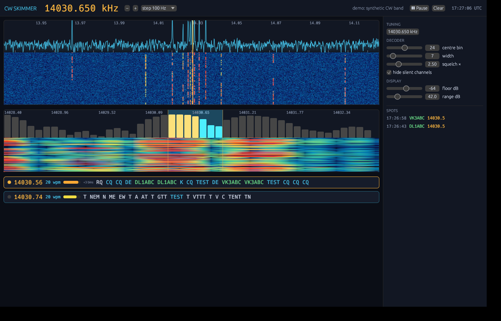

# cwskimmer (Rust)

A Rust port of the CW decoding engine of [JvanKatwijk/cwskimmer](https://github.com/JvanKatwijk/cwskimmer)
(GPL-2.0-or-later) with a new egui interface.



## How it works (same idea as upstream)

* 192 kHz I/Q in; every 2 ms (384 new samples, zero-padded) a 2048-point FFT is taken.
* 48 bins (93.75 Hz apart, ~4.5 kHz) around the tuned frequency each feed an independent
  on/off-keying decoder: tone/space durations are queued, the shortest space gives the dit
  length, a letter is cut at the first long gap and looked up in the Morse table.

## Differences from upstream

* The tuned frequency is mixed down to DC in software, so the 48 bins always follow the
  tuning inside the 192 kHz window (upstream only shifts the labels until the VFO retunes).
* Optional squelch: a tone must exceed *n ×* the noise floor (median of the 48 bins), which
  stops noise-only bins from printing `E T E T`. Set it to 0 for the upstream behaviour.
* Word gaps are detected at > 5 dits (upstream: > 3, which equals a letter gap).
* `/` and `=` added to the Morse table.
* The same signal appears in ~5 adjacent bins; the UI merges those into one card.
* UI: wide spectrum + waterfall (click/drag/scroll to tune), 48-bin spectrum + waterfall
  (click to move, scroll to resize the decoding window), live channel cards with callsign
  highlighting, a spots list (click to tune) and display controls.

Not ported: SDR drivers (SDRplay, HackRF, RTL-SDR). Add one by implementing
`source::IqSource`. Today the inputs are a built-in synthetic band (default) or a
192 kHz stereo I/Q `.wav`.

## Run

```bash
cargo run --release                         # GUI, demo band
cargo run --release -- recording.wav --center 14030000 --loop
cargo run --release --no-default-features --bin cwdecode -- --demo --seconds 40   # headless
cargo test --no-default-features
```

The GUI needs the usual egui/winit system libraries (X11 or Wayland, `libxkbcommon`, OpenGL).
Like upstream, the decoder holds back the last few elements of a transmission until more
keying arrives (it needs 14 queued elements before it emits a letter).
